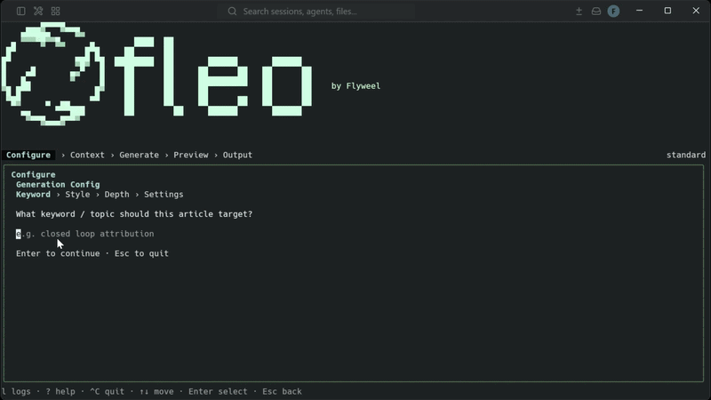

# Fleo by Flyweel (`@flyweel/fleo`)

[](./LICENSE)
[](https://nodejs.org)
[-3776ab.svg)](./tui/lib/pythonBootstrap.ts)
[](#multi-framework-site-learner--output-adapters)

**The open-source AI SEO + AEO (Answer-Engine Optimization) content engine for any startup, founder, or marketing team.**

Fleo researches live search results, real Reddit and Quora discussions, and your own website to write fact-checked, citation-verified articles designed to rank on Google **and** get cited by ChatGPT, Perplexity, Claude, and Google AI Overviews — then exports ready-to-publish files for **any** website stack.

> Sequel to [`openairlabs/flyweel-agentic-seo-aeo-engine`](https://github.com/openairlabs/flyweel-agentic-seo-aeo-engine) · Sister tool to [`openairlabs/seo-aeo-audit`](https://github.com/openairlabs/seo-aeo-audit) · Built and open-sourced by [Flyweel](https://www.flyweel.co)

<p align="center">
  
</p>

> [!NOTE]
> **Early public release (`v0.1.0`):** Fleo is live for early adopters and actively evolving. If you hit a bug, a framework quirk, or an edge case with your site stack, please [open an issue](https://github.com/openairlabs/fleo-by-flyweel/issues/new/choose) or send a PR.

---

## Table of Contents

**For Founders, Marketers & Non-Technical Builders**
- [What Fleo Does (In Plain English)](#what-fleo-does-in-plain-english)
- [Why Teams Use Fleo](#why-teams-use-fleo)
- [60-Second Quickstart (No Coding Required)](#60-second-quickstart-no-coding-required)
- [How to Publish to Your Website (Even Without Touching Code)](#how-to-publish-to-your-website-even-without-touching-code)
- [Choosing the Right Article Style](#choosing-the-right-article-style)
- [Interactive App Keyboard Shortcuts](#interactive-app-keyboard-shortcuts)
- [Companion Skills for Cursor, Claude Code, Lovable & OpenCode](#companion-skills-for-cursor-claude-code-lovable--opencode)

**For Developers, DevOps & Contributors**
- [System Architecture Overview](#system-architecture-overview)
- [The 7-Stage Generation Pipeline](#the-7-stage-generation-pipeline)
- [Repository Map](#repository-map)
- [Model Routing, BYOK & Per-Agent API Keys](#model-routing-byok--per-agent-api-keys)
- [Multi-Framework Site Learner & Output Adapters](#multi-framework-site-learner--output-adapters)
- [Frozen JSONL Bridge Protocol (`tui_bridge.py`)](#frozen-jsonl-bridge-protocol-tui_bridgepy)
- [CLI & Headless Automation Reference](#cli--headless-automation-reference)
- [Security & Trust Boundaries](#security--trust-boundaries)
- [Workspace Files & Environment Reference](#workspace-files--environment-reference)
- [Local Development, Testing & Quality Gates](#local-development-testing--quality-gates)
- [Troubleshooting & FAQ](#troubleshooting--faq)
- [Roadmap & Known Limitations](#roadmap--known-limitations)

---

## What Fleo Does (In Plain English)

If you ask a standard AI chatbot to *"write a blog post for my startup,"* three things usually go wrong:
1. **It sounds like generic AI filler** because it never read what real buyers are asking on Google, Reddit, or Quora today.
2. **It makes things up** — inventing fake statistics, broken links, or product features and pricing tiers your company doesn't actually offer.
3. **It hands you a wall of text** instead of a properly formatted webpage with search metadata, FAQs, citations, and structured data that search engines and AI assistants can read.

**Think of Fleo as a 4-person editorial team inside one terminal app:**

| Role Inside Fleo | What It Does For You |
|---|---|
| **1. Brand Researcher** | Reads your website (e.g. `https://yourcompany.com`) once to learn what you actually sell, what it costs, who your buyers are, who you compete with, and what words you never use. |
| **2. Live Web & Community Miner** | Searches live Google results ("People Also Ask" questions and competitor gaps) plus real **Reddit** and **Quora** threads to find the exact problems and phrasing real people use. |
| **3. Long-Form Writer & Line Editor** | Writes the article in three structured parts so it never cuts off mid-thought, pauses to let **you** review and leave notes, and runs a separate humanizing pass to strip robotic phrasing. |
| **4. Fact-Checker & Web Publisher** | Checks every cited link against the live sources gathered during research (deleting any invented URL), builds Google/AI `Schema.org` metadata and FAQs, and packages the post for your exact website builder. |

### What are SEO and AEO?
- **SEO (Search Engine Optimization)** helps your page show up when buyers type a question into **Google** or **Bing**.
- **AEO (Answer-Engine Optimization)** — also called **GEO** — structures your page with clear answer blocks, verified citations, comparison tables, and machine-readable `Schema.org` data so **ChatGPT, Perplexity, Claude, and Google AI Overviews** quote and link to your company when answering buyer questions.

Fleo optimizes every article for **both at the same time**.

---

## Why Teams Use Fleo

- **Zero Hallucinated Links or Fake Features** — Every external citation is checked against a live research ledger before saving; invented URLs are automatically stripped. Product mentions are locked to your verified Brand Profile.
- **Pennies Per Article, Zero SaaS Lock-In** — Fleo is 100% free and MIT-licensed. Bring your own [OpenRouter](https://openrouter.ai/keys) key and pay raw model cost: roughly **$0.23 per 2,500-word article** on the default Balanced preset (or **~$0.76** on Max flagship models), instead of $200–$500/month content subscriptions.
- **Works With Any Website Stack** — Native exports for **Next.js**, **Astro**, **Webflow**, **Framer**, **Nuxt**, **SvelteKit**, **Remix**, and **Universal Markdown**.
- **"Drop Into Any AI Builder" Mode (`agent-handoff.md`)** — Don't want to connect Fleo to your codebase? Every run generates a single `agent-handoff.md` file you can paste or drag into **Lovable, Bolt, v0, Cursor, Claude Code, Windsurf, or OpenCode**. It tells your builder exactly how to publish the post with full SEO/AEO intact.
- **Optional Google Search Console Guardrails** — Connect Search Console to automatically spot keyword cannibalization (so two of your own posts don't fight each other) and score real traffic opportunity before you spend a cent generating.
- **You Stay in the Driver's Seat** — Ask Fleo to pitch article angles (`Ctrl+G`), steer the angle in plain English, drop editorial notes while it runs (`c`), review the draft before final polish, and inspect a 0–100 Quality Scorecard before publishing.

---

## 60-Second Quickstart (No Coding Required)

### Before You Start (2 Things)
1. **Install Node.js 22 or newer** — Download the standard installer for Mac, Windows, or Linux at [nodejs.org](https://nodejs.org).
   *(You do **not** need to install Python or run terminal setup scripts — Fleo sets up its own private Python engine automatically on first launch.)*
2. **Grab one API key from [OpenRouter](https://openrouter.ai/keys)** — Create an account, add $5 of credit (enough for ~20 full articles), and copy your `sk-or-v1-...` key.

### Launch Fleo
Open **Terminal** (Mac/Linux) or **Windows Terminal / WSL** (Windows), navigate to any folder where you'd like your articles saved, and run:

```bash
npx @flyweel/fleo
```

### What Happens Next: The 5-Step Guided Setup Wizard
On your first run, Fleo opens a full-screen, arrow-key guided wizard:

1. **Step 1 · Engine Check** — Automatically creates an isolated Python runtime inside `~/.fleo/venv` so nothing conflicts with the rest of your computer.
2. **Step 2 · API Key & AI Models** — Paste your single `OPENROUTER_API_KEY`. Every pipeline step comes pre-configured with a **`[Default · Recommended]`** model, or you can open **Choose Models per Step** to switch models with the arrow keys (no model IDs to memorize).
3. **Step 3 · Your Company & Brand** — Paste your website URL (e.g. `https://yourstartup.com`) and Fleo scans your pages to learn your products, pricing, audience pain points, competitors, and tone. *(No live site yet? Pick the 5-question interview instead.)*
4. **Step 4 · How You Publish** — Pick **Agent Handoff Packet (`agent-handoff.md`)** *(Recommended — works safely with `Next.js`, `Astro`, `Webflow`, `Framer`, `Nuxt`, `SvelteKit`, `Remix`, or `Markdown`)*, **or** connect a local website repo for direct file publishing *(Experimental — best-effort for standard blogs; see [Option C](#option-c-direct-publish-to-a-local-website-repo-experimental))*.
5. **Step 5 · Write Your First Article** — Type a topic (or press **`Ctrl+G`** to have Fleo brainstorm high-intent article ideas for your audience), press **`Enter`**, and watch each research and writing stage complete live.

> **Tip:** Need to change your API key, switch AI models, or re-scan your website later? Press **`Ctrl+S`** anytime from the home Configure screen (or run `npx @flyweel/fleo setup`).

---

## How to Publish to Your Website (Even Without Touching Code)

Every time you save an article, Fleo creates a clean folder inside `output/generations/YYYY-MM-DD_<slug>/`:

```text
output/generations/2026-11-15_your-article-slug/
├── agent-handoff.md          # Drop-in file for Cursor, Claude Code, Lovable, Bolt, Windsurf, or OpenCode
├── final.mdx (or .md)        # Ready-to-use article formatted for your chosen framework
├── schema.json               # Complete Google & AI Schema.org @graph structured data
├── <slug>.webflow.html       # (Webflow / Framer mode) Clean CMS Rich Text HTML
├── <slug>.cms.csv            # (Webflow / Framer mode) 1-click CMS collection CSV import
├── <slug>.head-schema.html   # (Webflow / Framer mode) Copy-paste <script type="application/ld+json"> snippet
└── metadata.json             # 0–100 Quality Scorecard, word count, models used, and exact USD cost
```

Pick whichever publishing workflow fits how you manage your site:

### Option A: Using an AI Builder or Coding Assistant (Lovable, Cursor, Claude Code, Bolt, Windsurf)
1. Open your website project in **Lovable, Cursor, Claude Code, Windsurf, or OpenCode**.
2. Drag **`agent-handoff.md`** into the chat and say: *"Publish this article to our blog following the instructions in the file."*
3. `agent-handoff.md` has built-in instructions at the top that guide your AI assistant to match your existing blog layout, wire real internal links, attach the `Schema.org` JSON-LD without duplicates, check `robots.txt` for AI crawlers (`GPTBot`, `ClaudeBot`, `PerplexityBot`), and keep every word and citation intact.

### Option B: Using Webflow or Framer CMS (No Code)
1. Select **Webflow** or **Framer** in Step 4 of Setup.
2. Import **`<slug>.cms.csv`** directly into your Webflow or Framer Blog CMS Collection (or paste `<slug>.webflow.html` / `<slug>.framer.html` into your Rich Text field).
3. Paste **`<slug>.head-schema.html`** into the post's custom `<head>` code slot so Google and AI search engines see your FAQ and article schema.

### Option C: Direct Publish to a Local Website Repo *(Experimental)*

> [!WARNING]
> **Experimental feature:** Direct repo publishing (`P`) is best-effort and only auto-detects standard blog directories (such as `content/blog` or `src/content/blog`) and basic frontmatter keys. It does **not** automatically parse strict Zod / Content Collection / Contentlayer schemas, custom required frontmatter fields, bespoke MDX components, or repo formatting/linting rules (Prettier/ESLint).
>
> **Not confident configuring or customizing this?** Use **[Option A (`agent-handoff.md`)](#option-a-using-an-ai-builder-or-coding-assistant-lovable-cursor-claude-code-bolt-windsurf)** instead. It requires zero code changes and lets your coding agent inspect your site's exact conventions before writing and building.

For standard blog setups:
1. Point Fleo at your local website repository during Setup Step 4, or pass a specific target content folder directly:
   - **In the TUI Setup Step 4:** paste your repo root (and optionally enter a custom content folder path like `src/content/guides` on the next prompt), **or** paste the exact content subfolder path directly (Fleo walks up to detect your framework/git root while keeping your exact folder as the publish destination).
   - **Via CLI:** run `npx @flyweel/fleo detect-site-target --repo-path ./your-site --content-dir src/content/guides` (or omit `--repo-path` and pass an absolute `--content-dir /abs/path/to/posts`).
   - **Via `.env` override:** set `FLEO_BLOG_CONTENT_PATH=/abs/path/to/posts` to override `.fleo/site-contract.json` for a workspace.
2. When your article finishes, press **`P`** (capital `P`) on the Preview or Output screen to write the adapted file directly into your target folder. *(Fleo never runs `git commit` or `git push` behind your back; always review the diff and run your site's build/typecheck before committing.)*

#### Aligning a Cloned Copy of Fleo to Your Local Website Repo (Advanced)
If your site uses custom content collections, strict schemas, custom MDX components, or strict formatting rules and you want direct repo publishing (`P`) to match your repo out of the box, **clone Fleo locally** and paste this prompt into your AI coding agent (Claude Code, Cursor, OpenCode, Codex, or Windsurf):

```text
Align my local clone of Fleo (<PATH_TO_CLONED_FLEO>) so its experimental direct-repo publishing mode matches my local website repository (<PATH_TO_MY_SITE_REPO>).

1. Inspect my website repository first:
   - Identify the framework config, content collection directory, and schema definitions (e.g., Astro src/content/config.ts, Contentlayer/Velite/Zod schemas, or CMS types).
   - Read 2–3 existing published posts to capture exact frontmatter keys, value types (dates, author format, tags/categories, image fields, required custom fields), and file extensions.
   - Check the blog layout/route for existing JSON-LD and FAQ rendering, any custom MDX components/templates, and formatting/lint rules (Prettier/ESLint).

2. Inspect my local Fleo clone:
   - Read core/site_adapters.py, core/publisher.py, core/repo_extractor.py, and core/mdx_security.py.

3. Update ONLY my local Fleo clone's adapter/contract/publisher logic so direct publishing (`P`) writes posts that conform to my website repo's exact folder, frontmatter schema, conventions, and formatting:
   - Keep all fail-closed security boundaries in core/mdx_security.py intact (do not weaken URL, tag, ESM, or expression checks).
   - Do not auto-commit or auto-push in either repository.
   - Keep `agent-handoff.md` generation working as a fallback.

4. Verify before finishing:
   - Run Fleo's unit tests (`./venv/bin/pytest tests/ -m unit -q`) and fix any regressions.
   - Test a sample publish to a throwaway slug in my website repo (or temp copy) and run my website repo's typecheck/build (e.g., `astro check`, `next build`) to confirm zero schema or build errors, then remove the throwaway test file.
```

---

## Choosing the Right Article Style

Fleo includes **8 specialized article blueprints** (plus **3 depth levels**: `quick` ~1,500 words, `standard` ~2,500 words, `comprehensive` 4,000+ words):

| Style | Best Used When… | What Fleo Builds |
|---|---|---|
| **`standard`** | Covering a core topic buyers search to understand | Answer-first explainer with real community examples, data tables, and FAQs |
| **`guide`** | Teaching readers *how to do something* step-by-step | Actionable implementation guide with prerequisites, numbered steps, and troubleshooting |
| **`comparison`** | Comparing two approaches or Head-to-Head (`X vs Y`) | Side-by-side evaluation matrix, trade-offs, pricing facts, and buyer fit |
| **`top-compare`** | Writing *"Best [Category] Tools"* buyer guides (5, 8, 10, or 15 tools) | Scored multi-vendor roundup with consistent evaluation criteria and summary table |
| **`research`** | Publishing data-heavy benchmark or state-of-the-industry reports | Statistics-dense analysis prioritizing primary studies, benchmarks, and methodology |
| **`news`** | Reacting to an industry shift, launch, or point-of-view trend | Sharp editorial analysis explaining what changed, why it matters, and what to do next |
| **`category`** | Defining a product category (`What Is [Category]?`) | Definitive pillar page built to win top-of-funnel Google snippets and AI definitions |
| **`feature`** | Explaining a specific capability and the problem it solves | Problem-to-workflow breakdown connecting buyer pain points to concrete product capabilities |

You can also choose **Brand Mention Mode** per article:
- **`full` (Default)** — Naturally weaves your verified product and CTA where relevant.
- **`limited`** — Keeps the article 95% educational with only 2–3 light mentions.
- **`none`** — Purely educational thought leadership with zero product pitch.

---

## Interactive App Keyboard Shortcuts

The bottom bar of the app always shows the shortcuts available on your current screen, and pressing **`?`** opens the full shortcut guide anytime.

| Key | Where | Action |
|---|---|---|
| `↑` / `↓` & `Enter` | Everywhere | Move through options and confirm |
| `Esc` | Everywhere | Go back one screen, close an overlay, or cancel an active run (with confirmation) |
| `Ctrl+G` | Configure | Open **AI Keyword & Angle Ideas** tailored to your brand and Search Console data |
| `Ctrl+S` | Configure | Open **Setup & Brand Hub** (update API keys, pick models per step, re-scan brand) |
| `Tab` | Configure / Setup | Toggle Keyword vs. Editorial Angle framing (Configure) or 1-Key vs. Per-Agent Keys (Setup) |
| `Ctrl+T` | Configure / Ideas | Toggle fast vs. fresh live trend lookups |
| `Ctrl+N` | Ideas / Context | Regenerate topic suggestions or refresh pre-run angle context |
| `c` | Running | Queue an editorial note mid-run (applied before final polish) |
| `Ctrl+O` | Review / Preview | Expand the draft or final article to full-screen reading view (`PgUp`/`PgDn` to scroll) |
| `i` | Preview | Toggle article metadata & Quality Scorecard summary |
| `s` | Preview / Output | Save all adapted files + `agent-handoff.md` to `output/generations/` |
| `P` *(Shift+p)* | Preview / Output | Publish directly into your connected local website repo *(Experimental — prefer `s` + `agent-handoff.md` for custom schemas)* |
| `n` | Output | Start a new article |
| `l` | Any screen | Toggle live diagnostic & event log drawer |
| `?` | Any screen | Open keyboard shortcut help overlay |
| `Ctrl+C` twice | Any screen | Quit Fleo cleanly |

---

## Companion Skills for Cursor, Claude Code, Lovable & OpenCode

Fleo ships with two ready-made agent skills (`fleo-setup-brand` and `fleo-publish-post`) so your favorite AI coding agent knows how to configure your Brand Profile and integrate Fleo articles into your codebase:

```bash
# Install into Claude Code, OpenCode, Cursor, and Windsurf (skips existing files by default)
npx @flyweel/fleo install-skill

# Install for a single agent only, or pass --force to update existing skill files
npx @flyweel/fleo install-skill --agent claude-code --force
```

### The Open-Source AI Marketing Stack
Fleo is built to interoperate cleanly with open marketing skills:
- **Audit your live site first** with [`openairlabs/seo-aeo-audit`](https://github.com/openairlabs/seo-aeo-audit) — Runs a deterministic technical SEO + AEO audit across Next.js, Astro, Nuxt, SvelteKit, Remix, or WordPress to uncover the highest-ROI pages and content gaps to feed into Fleo.
- **Shared `.agents/product-marketing.md` context** — Whenever Fleo saves your Brand Profile, it syncs `.agents/product-marketing.md` in the format used by [`coreyhaines31/marketingskills`](https://skills.sh/coreyhaines31/marketingskills) (`product-marketing`, `ai-seo`, `page-cro`, `programmatic-seo`). Configure your company once and 70+ marketing skills share the same source of truth.

---
---

# Technical Reference & Architecture

The sections below cover Fleo's internal architecture, protocol contracts, model routing, security boundaries, headless CLI flags, and contributor test suites.

---

## System Architecture Overview

Fleo is split into two strictly isolated processes connected over a frozen **JSON Lines (`JSONL`) stdio protocol**:

1. **Interactive Terminal Frontend (`bin/fleo.js` + `tui/`)** — TypeScript, React 19, and Ink 7 running on Node.js ≥ 22. Owns alternate-screen rendering, responsive terminal layout (`tui/lib/useTerminalSize.ts`), keymap dispatch (`tui/keymap.ts`), cold-start Python runtime provisioning (`tui/lib/pythonBootstrap.ts`), and pure state transitions (`tui/state.ts`). It never imports Python or makes LLM calls directly.
2. **Async Content & Research Engine (`tui_bridge.py`, `generate.py`, `core/`)** — Plain async Python (`aiohttp` + `AsyncOpenAI`) running inside an isolated `~/.fleo/venv` (or repo `./venv`). Owns SSRF-safe brand crawling, live SERP/Reddit/Quora/GSC research, multi-model routing, 3-part generation, deterministic citation verification, fail-closed MDX/HTML security validation, quality scoring, and multi-framework adaptation.

```text
┌──────────────────────────────────────────────────────────────────────────────┐
│  Node.js >= 22  ·  React 19 + Ink 7 Full-Screen TUI  (bin/fleo.js, tui/*)    │
│  Configure  ›  Context  ›  Generate  ›  Review  ›  Preview  ›  Output        │
│  + 5-Step Setup Wizard & Per-Step Model Picker (Ctrl+S)                      │
└───────────────────┬──────────────────────────────────────▲───────────────────┘
                    │ stdin: JSONL commands                │ stdout: JSONL events
                    │ (review_decision, gsc_decision,      │ (run_plan, task_progress,
                    │  queue_comment, cancel)              │  artifact_ready, saved...)
┌───────────────────▼──────────────────────────────────────┴───────────────────┐
│  Python >= 3.10  ·  Async Engine & Bridge  (tui_bridge.py, generate.py)      │
│                                                                              │
│  ┌─────────────────────┐  ┌──────────────────────┐  ┌─────────────────────┐  │
│  │ Research & Context  │  │ SmartAIRouter        │  │ Quality & Security  │  │
│  │ • Perplexity Sonar  │  │ • Role Credentials   │  │ • Citation Ledger   │  │
│  │ • Reddit & Quora    │─▶│ • 3-Part Drafting    │─▶│ • Schema.org @graph │  │
│  │ • GSC Preflight     │  │ • Section Polish     │  │ • Fail-Closed MDX   │  │
│  │ • SSRF-Safe Crawler │  │ • BYOK / 402 Shrink  │  │ • GEO / AEO Scorer  │  │
│  └─────────────────────┘  └──────────────────────┘  └─────────────────────┘  │
└───────────────────────────────────────┬──────────────────────────────────────┘
                                        │ Atomic symlink-safe writes
┌───────────────────────────────────────▼──────────────────────────────────────┐
│  Workspace State & Outputs                                                   │
│  • .env (0600 API keys)           • .agents/product-marketing.md (synced)    │
│  • .fleo/brand/profile.json       • .fleo/site-contract.json                 │
│  • output/generations/<date>_<slug>/{agent-handoff.md, final.*, schema.json} │
└──────────────────────────────────────────────────────────────────────────────┘
```

---

## The 7-Stage Generation Pipeline

Every article run executes a deterministic sequence orchestrated by `ContentGenerator` (`core/generator.py`) and reported through `PipelineReporter` (`core/progress_reporter.py`):

1. **Stage 0 · GSC Preflight & Traffic Opportunity Gate (`core/gsc_analyzer.py`, `core/keyword_ideas.py`)**
   - Queries Google Search Console (when configured) to check whether an existing URL already ranks for the target query (cannibalization check) and computes a log-scaled **0–100% Opportunity Score** (`normalize_traffic_potential_score`) across semantically clustered queries.
   - If the score falls below the threshold (default `25`) and an interactive TUI session is attached, opens a human-in-the-loop `gsc_gate_opened` confirmation before spending tokens. Headless runs log a warning and proceed without blocking.
2. **Stage 1 · Parallel Multi-Source Research (`core/research.py`, `core/site_markdown.py`, `core/repo_extractor.py`)**
   - **SERP Intelligence**: Queries Perplexity Sonar (`sonar-reasoning-pro` by default) to extract top-ranking structural patterns, People Also Ask (PAA) questions, cited statistics, and content gaps.
   - **Community Mining**: Searches Reddit and Quora discussions, scores thread relevance via the fast classifier model, and extracts authentic practitioner pain points and objections.
   - **Authoritative Enrichment**: Optionally queries Interfaze (`INTERFAZE_API_KEY`) for academic and primary-source benchmarks on `--style research` runs.
   - **Brand Grounding**: Loads verified product facts, pricing, and internal routes from `.fleo/brand/profile.json`, live site markdown (`llms.txt` → `sitemap.xml` → clean HTML-to-Markdown), and/or connected repo blog posts (excluding drafts).
3. **Stage 2 · Angle Framing & Prompt Fencing (`core/context_intelligence.py`, `core/insight_formatter.py`)**
   - Synthesizes a sharp editorial angle, maps verified source URLs into an indexed citation directory, and wraps all external web, SERP, community, and crawled company text inside sanitized `<untrusted_external_data>` XML blocks with system-level anti-injection rules.
4. **Stage 3 · Segmented 3-Part Long-Form Drafting (`core/generator.py`, `core/ai_router.py`)**
   - Generates long-form articles in **3 sequential completions** rather than one monolithic prompt so models never hit output-token ceilings or compress middle sections:
     - **Part 1**: YAML frontmatter, answer-first opening TL;DR, core definitions, and foundational mechanics.
     - **Part 2**: Deep-dive workflows, comparison matrices, benchmark tables, and community-grounded examples.
     - **Part 3**: Edge cases, troubleshooting, actionable takeaways, and inline source attributions.
5. **Stage 4 · Formatting, Schema `@graph` & Citation Ledger Verification (`core/formatter.py`, `core/faq_builder.py`, `core/schema_generator.py`, `core/citation_verifier.py`)**
   - Normalizes heading hierarchy, builds visible body FAQs matching PAA intent, and compiles a linked `Schema.org` `@graph` (`Organization`, `Person`, `WebPage`, `BlogPosting`, `BreadcrumbList`, and `FAQPage`).
   - Converts inline `[Source](url)` attributions into numbered `<span id="cite-N">` footnotes and runs `verify_citations_against_ledger`: any external URL not present in the run's verified research ledger (or `BrandProfile` allowlist) is stripped back to plain text so hallucinated URLs never ship.
6. **Stage 5 · Pre-Polish HITL Review Gate & Segmented Refinement (`core/ai_router.py`, `core/content_scrubber.py`)**
   - In interactive mode, opens `review_gate_opened` so the user can inspect the assembled draft, queue inline revision comments, approve polish, or skip polish.
   - Runs proportional `max_tokens` section-by-section editorial polishing (humanizing sentence cadence, removing AI clichés/banned words, applying user notes) followed by surgical H2, title, meta description, and TL;DR optimization passes.
   - Long-output editing/polishing passes explicitly disable hidden reasoning tokens on Nebius/OpenRouter models (`OR_PROVIDER_NEBIUS_FAST`) so thinking budgets never starve output generation.
7. **Stage 6 · Fail-Closed Security Validation, Quality Scorecard & Stack Adaptation (`core/mdx_security.py`, `core/content_validator.py`, `core/quality_judge.py`, `core/site_adapters.py`, `core/artifacts.py`)**
   - Runs `assert_safe_mdx` on both canonical and framework-adapted outputs before touching disk.
   - Computes the deterministic **0–100 Quality Scorecard** (AEO directness, citation density, heading structure, readability, keyword stuffing checks) plus optional `--judge` LLM-as-judge Princeton GEO dimensions (`clarity`, `fluency`, `authoritative_tone`).
   - Adapts components, frontmatter keys, and file formats to the target website framework and writes `agent-handoff.md`, `schema.json`, and `metadata.json`.

---

## Repository Map

```text
fleo-by-flyweel/
├── bin/fleo.js                  # Node CLI entrypoint invoked by `npx @flyweel/fleo` / `fleo`
├── tui/                         # TypeScript + React 19 + Ink 7 full-screen terminal application
│   ├── cli.tsx                  # Commander subcommands (`setup`, `generate`, `install-skill`, etc.)
│   ├── App.tsx                  # Top-level journey router, overlays, and lifecycle orchestration
│   ├── state.ts                 # Pure reducer for journey state & JSONL bridge events
│   ├── bridge.ts                # Async child-process client, JSONL parser & ANSI/OSC sanitizer
│   ├── keymap.ts                # Single source of truth for keyboard shortcuts, footer & `?` help
│   ├── modelCatalog.ts          # Curated per-step model presets (`[Default · Recommended]`, BYOK, Budget)
│   ├── components/              # Responsive TUI views (`setupView`, `config`, `review`, `previewView`, …)
│   └── lib/                     # `pythonBootstrap.ts` (`uv`/venv), `altScreen.ts`, terminal themes
├── tui_bridge.py                # Stdout-pure JSONL bridge runner connecting Ink TUI <-> Python engine
├── generate.py                  # Standalone Rich interactive & headless (`--no-int --json`) Python CLI
├── reddit_scraper.py            # Repo-only standalone Reddit/community pain-point miner (not in npm tarball)
├── core/                        # Flat async Python engine modules (intentionally NO `__init__.py`)
│   ├── generator.py             # End-to-end 7-stage pipeline orchestrator
│   ├── ai_router.py             # Multi-provider OpenAI/OpenRouter/Gemini routing & 402/BYOK resilience
│   ├── agent_credentials.py     # Per-role API key, base URL & model resolver + live key connectivity probe
│   ├── brand_profile.py         # Pydantic `BrandProfile` model & `.agents/product-marketing.md` sync
│   ├── research.py              # Perplexity Sonar SERP, Reddit, Quora, GSC & Interfaze clients
│   ├── site_markdown.py         # SSRF-pinned `llms.txt` + `sitemap.xml` + HTML->Markdown brand crawler
│   ├── site_extractor.py        # AI structured brand capability & pricing extractor
│   ├── site_adapters.py         # Multi-framework learner, MDX/HTML/CSV adapters & `agent-handoff.md`
│   ├── citation_verifier.py     # Deterministic research-ledger URL verifier & stripper
│   ├── schema_generator.py      # Linked Schema.org `@graph` builder
│   ├── mdx_security.py          # Unmasked fail-closed MDX/JSX/HTML/Svelte security validator
│   ├── url_safety.py            # Public-IP DNS pinning, redirect validation & `<untrusted_external_data>`
│   ├── content_validator.py     # Deterministic SEO/AEO/readability rubric scorer
│   ├── quality_judge.py         # Optional LLM-as-judge scorer for GEO clarity, fluency & tone
│   ├── gsc_analyzer.py          # Search Console cannibalization & opportunity analyzer
│   ├── keyword_ideas.py         # Brand- & GSC-grounded topic ideation engine
│   ├── tui_bridge.py            # JSONL emitter, `.env` atomic merger & HITL gate primitives
│   ├── paths.py                 # Workspace path resolver, `.env` key allowlist & symlink-safe atomic writes
│   └── cli/                     # Rich CLI prompts, live progress panels & output helpers for `generate.py`
├── config/                      # Runtime JSON rules (SEO thresholds, quality rubric, research config)
├── prompts/                     # Brand context extraction prompt templates
├── skills/                      # Bundled coding-agent skills (`fleo-setup-brand`, `fleo-publish-post`)
├── examples/profiles/           # Reference `BrandProfile` configs (`acme-cloud-saas`, `pulse-ai-startup`)
├── eval/                        # Offline deterministic SEO/AEO regression harness & golden baselines
└── tests/                       # 680+ Python unit tests (`pytest`) + 185 TypeScript TUI tests (`vitest`)
```

> **Contributor invariant:** `core/` intentionally has **no `__init__.py`**. Top-level entrypoints (`tui_bridge.py`, `generate.py`, `eval/run_quality_eval.py`, and `tests/`) insert the package root onto `sys.path`. Do not add `core/__init__.py`.

---

## Model Routing, BYOK & Per-Agent API Keys

Fleo supports two credential modes out of the box (configurable in **Setup Wizard Step 2**, **`Ctrl+S`**, or `.env`):

1. **1-Key Quickstart (Recommended)** — Set `OPENROUTER_API_KEY` alone. Every agent role (including Perplexity Sonar web search via `perplexity/sonar-reasoning-pro` on OpenRouter) routes automatically through OpenRouter.
2. **Granular Per-Agent Keys & Model Overrides** — Assign separate API keys, models, or custom HTTPS gateways (`FLEO_<ROLE>_BASE_URL` exported in your shell environment and paired with `FLEO_<ROLE>_API_KEY`) to individual pipeline roles to split team billing, isolate rate limits, or call native vendor APIs directly (`PERPLEXITY_API_KEY` preserves native Sonar `search_domain_filter` and raw citation arrays; `GOOGLE_API_KEY` calls Google AI Studio directly).

| Pipeline Role | Dedicated API Key Env | Model Override Env | `balanced` Default (~$0.23/post) | `max` Default (~$0.76/post) |
|---|---|---|---|---|
| **1 · Web & Community Research** | `FLEO_RESEARCH_API_KEY` *(or `PERPLEXITY_API_KEY`)* | `FLEO_RESEARCH_MODEL` | `sonar-reasoning-pro` | `sonar-reasoning-pro` |
| **2 · Article Writer (Draft)** | `FLEO_DRAFT_API_KEY` | `FLEO_DRAFT_MODEL` | `openai/gpt-6-sol` | `anthropic/claude-opus-5.5` |
| **3 · Humanizer & Polish** | `FLEO_POLISH_API_KEY` | `FLEO_POLISH_MODEL` | `anthropic/claude-sonnet-5.5` | `anthropic/claude-opus-5.5` |
| **4 · SEO, Headings & Edits** | `FLEO_SEO_API_KEY` *(or `GOOGLE_API_KEY`)* | `FLEO_SEO_MODEL` | `google/gemini-3.8-flash` | `google/gemini-3.8-flash` |
| **5 · Fast Classifier & Judge** | `FLEO_LIGHT_API_KEY` | `FLEO_LIGHT_MODEL` | `openai/gpt-6-luna` | `openai/gpt-6-luna` |
| **6 · Semantic Embeddings** | `FLEO_EMBED_API_KEY` | `FLEO_EMBED_MODEL` | `qwen/qwen3-embedding-8b` | `qwen/qwen3-embedding-8b` |
| **7 · Brand Website Extractor** | `FLEO_EXTRACTOR_API_KEY` *(inherits Step 5)* | `FLEO_EXTRACTOR_MODEL` | `openai/gpt-6-luna` | `openai/gpt-6-luna` |
| **8 · Typed Audit Decisions** | `FLEO_DECISIONS_API_KEY` | `FLEO_JEV_ENABLED=1\|0` | `typesafe/jev-1.13` | `typesafe/jev-1.13` |

### Built-In BYOK & OpenRouter `402` Resilience
Many teams use OpenRouter with **BYOK (Bring Your Own Key)** for a single provider (e.g., an OpenAI key linked to OpenRouter with low platform credits). If a secondary model (such as Anthropic Polish) returns HTTP `402` (insufficient OpenRouter credits or missing provider key):
- `SmartAIRouter` parses the affordable token ceiling from the `402` response and shrinks `max_tokens` proportionally when possible; or
- Automatically falls back to your working `DRAFT` model (`model_generation`) and pins that fallback for the remainder of the run so multi-section polishing completes cleanly without repeated errors.

---

## Multi-Framework Site Learner & Output Adapters

`core/site_adapters.py` decouples canonical article generation from framework-specific syntax:

- **Automatic Repo Inspection (`learn_site_contract_from_repo`, Experimental)**: Best-effort inspection of framework config files (`next.config.*`, `astro.config.*`, `nuxt.config.*`, `svelte.config.*`, `remix.config.*`), standard blog content directories (`content/blog`, `src/content/blog`, `app/content/blog`, etc.) or an explicit `--content-dir` / content subfolder path, and up to 5 existing Markdown/MDX posts to learn common frontmatter keys (`title`, `description` vs. `summary` vs. `excerpt`, `publishDate` vs. `date` vs. `publishedAt`, `tags`, and image shape) into `.fleo/site-contract.json`. Does not parse custom Zod/Contentlayer schemas, bespoke MDX components, or repo formatters. Use [`agent-handoff.md`](#option-a-using-an-ai-builder-or-coding-assistant-lovable-cursor-claude-code-bolt-windsurf) by default, or follow the [local clone alignment prompt](#aligning-a-cloned-copy-of-fleo-to-your-local-website-repo-advanced) for custom repos.
- **Target Outputs by Framework**:

| Target ID | Primary File | How Components, Schema & Prose Are Adapted |
|---|---|---|
| `nextjs` | `final.mdx` | Portable Markdown tables/callouts, JSX-safe prose brace escaping, `schema.json` + `agent-handoff.md` |
| `astro` | `final.mdx` | Content-collection-compatible frontmatter & portable MDX body, `schema.json` + `agent-handoff.md` |
| `nuxt` | `final.md` | `@nuxt/content`-clean Markdown with MDC-safe syntax, `schema.json` + `agent-handoff.md` |
| `sveltekit` | `final.md` | `mdsvex`-safe Markdown (prose braces escaped so Svelte never treats `{x}` as expressions), `schema.json` |
| `remix` | `final.mdx` | Remix MDX route/collection frontmatter + clean portable body, `schema.json` + `agent-handoff.md` |
| `webflow` | `final.md` + extras | Generates `<slug>.webflow.html` (Rich Text), `<slug>.cms.csv` (formula-sanitized CSV), and `<slug>.head-schema.html` |
| `framer` | `final.md` + extras | Generates `<slug>.framer.html` (Rich Text), `<slug>.cms.csv` (formula-sanitized CSV), and `<slug>.head-schema.html` |
| `markdown` | `final.md` | Pure portable CommonMark + GFM tables, visible FAQs, `schema.json`, and `agent-handoff.md` |

---

## Frozen JSONL Bridge Protocol (`tui_bridge.py`)

External tools, CI jobs, or custom UIs can drive the Python engine directly via `tui_bridge.py`. `stdout` is strictly reserved for newline-delimited JSON (`JSONL`); all logging is routed to `stderr`.

- **Events emitted on `stdout`**: `setup_status`, `run_plan`, `phase_started`, `task_progress`, `tool_call`, `artifact_ready`, `review_gate_opened`, `review_gate_closed`, `gsc_gate_opened`, `gsc_gate_closed`, `generation_complete`, `saved`, `published`, `warning`, `error`.
- **Commands accepted on `stdin` during `generate`**:
  - `{"type": "queue_comment", "runId": "...", "comment": "Emphasize SOC2 trade-offs"}`
  - `{"type": "review_decision", "runId": "...", "decision": "approve", "comment": "..."}` (`approve` | `skip_polish` | `abort`)
  - `{"type": "gsc_decision", "runId": "...", "decision": "proceed"}` (`proceed` | `abort`)
  - `{"type": "cancel", "runId": "..."}`

---

## CLI & Headless Automation Reference

### Node / `npx` CLI (`@flyweel/fleo`)

```bash
# Launch interactive TUI (opens Setup Wizard automatically on unconfigured workspaces)
npx @flyweel/fleo
npx @flyweel/fleo --theme theme-flyweel   # Themes: theme-flyweel | theme-opencode | theme-high-contrast | theme-neutral-dark

# Open the Setup & Brand Onboarding Wizard directly
npx @flyweel/fleo setup

# Launch TUI with generation parameters pre-filled
npx @flyweel/fleo generate \
  -k "postgres branching for preview environments" \
  --style guide \
  --depth standard \
  --community-mode full \
  --brand-mode full

# Non-interactive CI / environment health check (exits cleanly without opening alternate screen)
npx @flyweel/fleo --no-tui

# Non-interactive workspace setup helpers (emit JSONL progress on stdout)
npx @flyweel/fleo scan-brand-url --url https://yourstartup.com
npx @flyweel/fleo detect-site-target --repo-path ./your-website-repo
npx @flyweel/fleo detect-site-target --repo-path ./your-website-repo --content-dir src/content/guides

# Install companion skills into Claude Code, OpenCode, Cursor, and/or Windsurf
npx @flyweel/fleo install-skill --agent all
npx @flyweel/fleo install-skill --agent cursor --force
```

### Headless Python CLI (`generate.py`)

For cron jobs, batch scripts, or CI pipelines where you want pure headless execution with structured JSON output:

```bash
# Use ~/.fleo/venv/bin/python (auto-provisioned by `npx @flyweel/fleo`) or local ./venv/bin/python
./venv/bin/python generate.py --no-int \
  -k "postgres branching for preview environments" \
  --style guide \
  --depth standard \
  --local \
  --json
```

Common `generate.py` flags:
- `-k, --keyword <text>` — Target keyword or topic (required with `--no-int`).
- `--style <style>` — `standard` | `guide` | `comparison` | `top-compare` | `research` | `news` | `category` | `feature`.
- `--depth <depth>` — `quick` (~1,500w) | `standard` (~2,500w) | `comprehensive` (4,000w+).
- `--solutions <5|8|10|15>` — Number of ranked vendors for `--style top-compare` (default `8`).
- `--comp "Vendor A, Vendor B"` / `--nc` — Pin specific competitors or disable competitor mentions completely.
- `--lfw` / `--nfw` — Limited brand mentions (`2–3`) or zero brand mentions (educational-only).
- `--nr` / `--nrl` — Skip Reddit/Quora mining (`--nr`) or cap to top 3 Reddit + 1 Quora thread (`--nrl`).
- `--note "editorial direction"` — Steer angle, examples, or tone.
- `--judge` — Include LLM-as-judge GEO subjective dimensions (`clarity`, `fluency`, `authoritative_tone`) in `metadata.json`.
- `--save-research` — Persist raw SERP and community research payloads alongside metadata.
- `--no-gsc-check` / `--no-gsc-keywords` — Skip Google Search Console preflight checks.
- `--local` / `--publish` / `--no-draft` — Save locally to `output/generations/` or publish into the connected blog path.
- `--json` — Emit machine-readable JSON result summary on stdout.

*(Working from a source clone? `reddit_scraper.py` is also available as a standalone community research CLI via `./venv/bin/python reddit_scraper.py --t "database schema migrations"`.)*

---

## Security & Trust Boundaries

Fleo treats **all** LLM outputs, crawled web pages, community threads, and repository inputs as untrusted data. See [`SECURITY.md`](./SECURITY.md) for vulnerability reporting and full boundary details:

1. **Unmasked Fail-Closed Markup Validation (`core/mdx_security.py`)**: Scans the full article body without regex code-fence masking so Markdown/MDX parser differentials cannot smuggle live `{expr}` JS/Svelte expressions. Rejects `<script>`, `<iframe>`, `<object>`, `<base>`, `on*=` event handlers, `dangerouslySetInnerHTML`, Svelte `{@html}`, unapproved ESM `import`/`export` statements (including non-ASCII and spaceless specifiers), nested tag starts, control characters, and non-`http(s)`/`mailto` link destinations before any file is written.
2. **DNS-Pinned SSRF Protection (`core/url_safety.py`, `core/site_markdown.py`)**: Resolves DNS and blocks loopback (`127.0.0.0/8`, `::1`), RFC1918 private networks, link-local/cloud metadata (`169.254.169.254`), and CGNAT ranges on **every** redirect hop with socket-level IP verification, same-origin sitemap-index caps, and wall-clock HTTP deadlines.
3. **Indirect Prompt-Injection Fencing**: Crawled pages (excluding external `llms.txt` links), SERP summaries, Reddit/Quora snippets, and compliance rules are sanitized against zero-width/full-width tag breakouts and wrapped in `<untrusted_external_data>` XML fences. `agent-handoff.md` and `.agents/product-marketing.md` sanitize crawled fields and declare explicit untrusted-data boundaries for downstream coding agents.
4. **Secret & `.env` Isolation (`core/paths.py`, `core/agent_credentials.py`, `core/tui_bridge.py`)**:
   - API keys are written atomically to `.env` with `0600` permissions (refusing symlinks and warning via `git check-ignore` if `.env` is unignored).
   - `load_repo_env` enforces a strict Fleo variable allowlist and blocks proxy/TLS/runtime hijack variables (`HTTPS_PROXY`, `SSL_CERT_FILE`, `GOOGLE_APPLICATION_CREDENTIALS`, `FLEO_PYTHON`, `FLEO_WORKDIR`, and all `*_BASE_URL` overrides).
   - Provider-native keys (`OPENROUTER_API_KEY`, `PERPLEXITY_API_KEY`, `GOOGLE_API_KEY`, `GEMINI_API_KEY`) are pinned to their official HTTPS endpoints, and unknown/ambiguous key prefixes (such as bare `sk-` keys) are refused unless paired with an explicit shell-exported HTTPS `FLEO_<ROLE>_BASE_URL`.
5. **Terminal Escape & CSV Formula Neutralization (`tui/bridge.ts`, `core/site_adapters.py`)**: Strips OSC (`52` clipboard, `8` hyperlink, window title), CSI/SGR, and C0/C1 control sequences from bridge events and stderr, and neutralizes spreadsheet formula prefixes (`=`, `+`, `-`, `@`) in Webflow/Framer `.cms.csv` exports.
6. **Isolated Runtime Bootstrap (`tui/lib/pythonBootstrap.ts`)**: Spawns Python and `uv` bootstrap commands from Fleo's own `installationRoot` with `PYTHONSAFEPATH=1` and `UV_NO_CONFIG=1` so untrusted modules or `uv.toml` files in the current working directory are never executed.

> **Workspace safety note:** As with any developer CLI, inspect `.env` and `.fleo/` before running Fleo inside an untrusted third-party repository.

---

## Workspace Files & Environment Reference

Fleo scopes all user configuration and generated artifacts to your active workspace directory (defaults to `process.cwd()`, overridable via `FLEO_WORKDIR=/path/to/workspace`):

| Path | Tracked in Git? | Purpose |
|---|---|---|
| `.env` | **Never** (`0600`) | API keys, model overrides, optional GSC / IndexNow / Interfaze credentials |
| `.fleo/brand/profile.json` | Optional | Validated `BrandProfile` JSON (products, pricing, ICP pains, voice, competitors) |
| `.fleo/brand/site_snapshot.md` | Optional (cache) | Cached clean Markdown from your scanned website pages |
| `.fleo/site-contract.json` | Optional | Target framework (`nextjs`, `astro`, `webflow`, etc.) & learned frontmatter keys |
| `.agents/product-marketing.md` | Optional | Human- & agent-readable marketing context synced automatically from `BrandProfile` |
| `output/generations/` | Optional | Timestamped article output folders (`agent-handoff.md`, `final.*`, `schema.json`, `metadata.json`) |

See [`.env.example`](./.env.example) for a complete, commented template of all supported environment variables.

---

## Local Development, Testing & Quality Gates

Prerequisites for contributors: **Node.js ≥ 22**, **pnpm 10+**, and **Python 3.10–3.13**.

```bash
# 1. Create local Python virtualenv with runtime + test dependencies
python3 -m venv venv
./venv/bin/pip install --upgrade pip
./venv/bin/pip install -r requirements-dev.txt

# 2. Install Node dependencies & compile TypeScript TUI
pnpm install
pnpm build

# 3. Run the 4 required CI verification gates (all run 100% offline, no API keys needed)
./venv/bin/pytest tests/ -m unit -q               # 680+ Python unit & security tests
./venv/bin/python eval/run_quality_eval.py --ci   # Deterministic SEO/AEO/readability regression gate
pnpm typecheck                                    # TypeScript strict check (`tsc --noEmit`)
pnpm test                                         # 185 Vitest + ink-testing-library TUI tests
```

Additional developer workflows:
- **Run TUI in watch/dev mode (no build step)**: `pnpm dev`
- **Run live paid-API integration suite** *(requires `.env` keys)*: `./venv/bin/pytest -m integration`
- **Run quality eval with live LLM-as-judge**: `./venv/bin/python eval/run_quality_eval.py --judge`
- **Inspect packed npm tarball**: `npm pack --dry-run`

---

## Troubleshooting & FAQ

<details>
<summary><strong>"command not found: npx" or Node version warning</strong></summary>

Ink 7 requires **Node.js 22 or newer**. Check `node -v` in your terminal. If it prints `v20` or older (or `command not found`), install the current LTS release from [nodejs.org](https://nodejs.org) (or run `nvm install 22 && nvm use 22`).
</details>

<details>
<summary><strong>Do I need to install Python myself?</strong></summary>

Usually no. On first launch, Fleo checks for `uv` or Python ≥ 3.10 and automatically creates an isolated virtual environment at `~/.fleo/venv` with all pinned engine packages from `requirements.txt`. If you want to point Fleo at a custom interpreter, set `FLEO_PYTHON=/path/to/python`.
</details>

<details>
<summary><strong>How do I manage multiple clients or brands on one machine?</strong></summary>

Create one folder per brand (for example `~/brands/acme` and `~/brands/globex`) and run `npx @flyweel/fleo` inside each folder — or pass `FLEO_WORKDIR=~/brands/acme npx @flyweel/fleo`. Each workspace keeps its own `.fleo/brand/profile.json`, `.agents/product-marketing.md`, `.fleo/site-contract.json`, and `output/` history while sharing the cached `~/.fleo/venv` Python runtime.
</details>

<details>
<summary><strong>OpenRouter returned a 402 credit error on Polish — what happened?</strong></summary>

If you use an OpenAI-only BYOK setup on OpenRouter with minimal OpenRouter wallet credits, calling Anthropic Claude for Step 3 (Polish) may return HTTP `402`. Fleo automatically recovers mid-run by falling back to your Draft model. To avoid the retry altogether, press `Ctrl+S` → **Choose Models per Step** → **Step 3 · Humanizer & Polish** and select **OpenAI GPT-6 Sol `[OpenAI / BYOK]`**.
</details>

---

## Roadmap & Known Limitations

Fleo `v0.1.0` ships the full end-to-end research, writing, citation verification, and multi-framework export pipeline. Current focus areas and known limitations:

- **Direct Local Repo Publishing (`[Experimental]`)**: Works best on standard Markdown/MDX blog folders (`Next.js`, `Astro`, `Nuxt`, `SvelteKit`, `Remix`) and supports custom folder paths via Step 4 or `--content-dir`. Sites with custom MDX components, strict content schemas, or headless CMS pipelines should use the recommended **`agent-handoff.md`** workflow or align a local clone with your coding agent.
- **CMS Connectors**: Webflow and Framer currently export Rich Text HTML, sanitized CMS CSVs, and head schema snippets (`agent-handoff.md` included). Direct API publishing for Webflow, Framer, Ghost, and Sanity is on the roadmap.
- **Image & Diagram Generation**: Hero and section image prompts are emitted in `metadata.json` and `agent-handoff.md`; automated asset generation and upload adapters are planned.
- **Windows Terminal Support**: Native macOS, Linux, and WSL2 terminals are the primary tested targets; native Windows PowerShell and cmd rendering edge cases are still being hardened.
- **Model Presets**: Model defaults in `config/` evolve as newer models land on OpenRouter, Perplexity, and Google AI Studio. Bug reports, adapter improvements, and PRs are welcome in [Issues](https://github.com/openairlabs/fleo-by-flyweel/issues/new/choose).

---

## Contributing, Security & License

- **Contributing Guide**: [`CONTRIBUTING.md`](./CONTRIBUTING.md)
- **Security Policy & Vulnerability Reporting**: [`SECURITY.md`](./SECURITY.md) (GitHub Private Vulnerability Reporting)
- **Code of Conduct**: [`CODE_OF_CONDUCT.md`](./CODE_OF_CONDUCT.md)
- **Changelog**: [`CHANGELOG.md`](./CHANGELOG.md)
- **License**: [MIT](./LICENSE) — Built by [Flyweel](https://www.flyweel.co) as an open-source contribution for marketers, founders, and builders.
